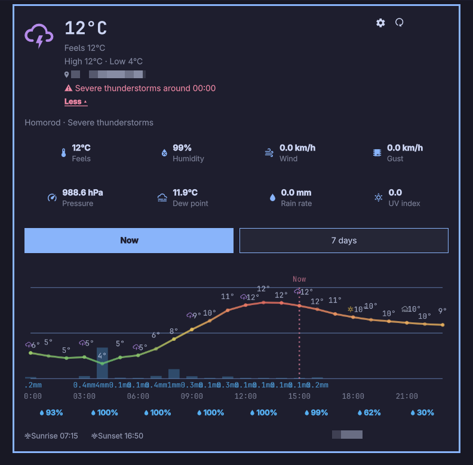
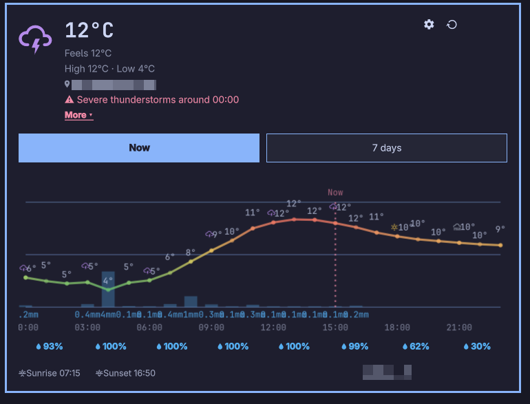
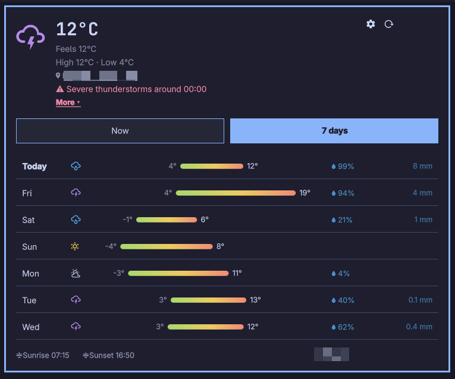
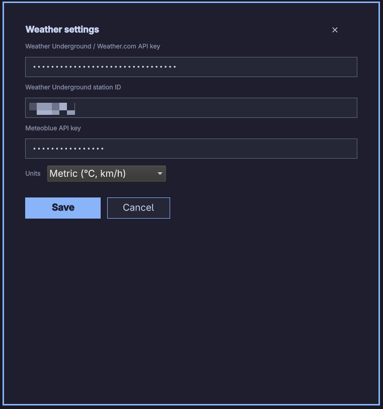

# Omarchy PWS Weather

**Your personal weather station, right in the Omarchy bar.**

Omarchy PWS Weather is designed primarily for **personal weather stations (PWS) registered with Weather Underground**. Connect a station ID and your Weather Underground / Weather.com API key to see the station's current measurements alongside an hourly outlook and a seven-day forecast.

**No station or API key?** Leave the Weather.com key empty to use the built-in **Open-Meteo fallback**, with current weather and forecasts for a selected location or your approximate public-IP location.

This Omarchy / Quickshell port is based on the Wunderground Extended KDE plasmoid. It follows the shell's theme and combines a compact bar widget with a detailed popup.

## Weather sources and fallback

| Configuration | Current measurements | Hourly and daily forecast |
| --- | --- | --- |
| Weather.com key + PWS station ID | Your selected Weather Underground station | Open-Meteo at the station's coordinates |
| Weather.com key + Traveling mode | A nearby available Weather Underground station | Open-Meteo at that station's coordinates |
| Weather.com key left empty | Open-Meteo for the selected or IP-derived location | Open-Meteo for the same location |
| Optional Meteoblue key added to any mode | Unchanged | Meteoblue replaces the default forecast provider |

The fallback is a **stationless operating mode**, selected by leaving the Weather.com key empty. An invalid key, unavailable station, or failed PWS request displays an error; it does not automatically switch to Open-Meteo. To use location-based weather instead, clear the Weather.com key in settings.

PWS measurements and forecasts are separate data sources: the station supplies local observations, while Open-Meteo or Meteoblue supplies the outlook. Condition icons and text also use provider weather data, including the current hourly forecast; they are not measurements made by the station. In fallback mode, current weather comes from Open-Meteo rather than a personal station.

With a Meteoblue key, the plugin requests the `basic-1h` and `basic-day` packages together. Open-Meteo still supplies supplemental sunrise, sunset, and daily precipitation data. A failed Meteoblue request displays an error rather than automatically changing forecast providers.

## Requirements and installation

- Omarchy with the Quickshell-based `omarchy-shell` and schema-version-1 plugin support (originally developed for Omarchy 4).
- `curl` and an internet connection for weather requests.
- A Weather Underground / Weather.com API key and station ID for PWS mode.
- No API key for the default Open-Meteo mode or forecasts.
- An optional Meteoblue API key for alternative forecasts.

For a downloaded copy, place the plugin files directly in:

```text
~/.config/omarchy/plugins/omarchy_pws_weather/
├── manifest.json
├── BarWidget.qml
├── Panel.qml
├── WeatherModel.js
├── README.md
└── LICENSE
```

Then validate and enable it:

```bash
omarchy plugin validate ~/.config/omarchy/plugins/omarchy_pws_weather
omarchy plugin enable omarchy_pws_weather centerEnd
```

`centerEnd` places the widget beside the center section. You can move it later through Omarchy's bar settings. The plugin ID is `omarchy_pws_weather` and only one instance is supported.

## First-time setup

### Where to get API keys and station details

| Provider / setting | Where to get it | What to enter |
| --- | --- | --- |
| Weather Underground / Weather.com API key | Sign in to [Weather Underground → API Keys](https://www.wunderground.com/member/api-keys), then create or copy your key. See the provider's [PWS API-key instructions](https://support.weather.com/s/article/How-to-Get-a-Copy-of-Your-Personal-Weather-Station-PWS-Data). | Paste the API key into **Weather Underground / Weather.com API key** (`apiKey`). If your account cannot issue a key, use the Open-Meteo fallback. |
| Weather Underground station ID | Open [Weather Underground → My Devices](https://www.wunderground.com/member/devices) and find your registered station. | Copy the case-sensitive **Station ID** into **Weather Underground station ID** (`stationId`). The station ID is an identifier, not a secret. |
| Meteoblue API key (optional) | Follow [Meteoblue → API Access](https://docs.meteoblue.com/en/weather-apis/introduction/overview). The provider explains how to contact them for an API-key trial and ongoing access. | Request access to the Forecast API packages **basic-1h** and **basic-day**, then paste the issued key into **Meteoblue API key** (`meteoblueApiKey`). A website account alone is not an API key. |
| Open-Meteo | No key to obtain for the public endpoints used here; see [Open-Meteo's access information](https://open-meteo.com/en/about). | Leave the Weather.com key empty for stationless mode, or leave the Meteoblue key empty for default forecasts. Open-Meteo's free API is intended for non-commercial use and is subject to its usage limits. |
| IPinfo (automatic location) | No token to obtain for this plugin. | The plugin calls the public `ipinfo.io/json` endpoint and has no IPinfo token setting. |

The Weather Underground **API key** is different from the **Station Key / upload password** used by weather-station hardware. This plugin reads weather data and does not need that upload secret or your provider account password. Meteoblue signing secrets are also not used by this implementation; it supports direct API-key requests.

The Weather Underground account pages require sign-in. Enter credentials only in the local widget settings; never add real keys to this README or commit your shell configuration.

### Connect your personal weather station

1. Click the weather widget, then the gear icon beside Refresh.
2. Enter your **Weather Underground / Weather.com API key**.
3. Enter the **Weather Underground station ID** exactly as registered; it is case-sensitive.
4. Choose your units and click **Save**.

The widget fetches current observations from that station and uses its coordinates for forecasts. You can open the station's Wunderground dashboard by right-clicking the bar widget.

### Use weather without a personal station

1. Open the gear menu and leave the Weather.com API key empty.
2. The station-ID field is replaced by **Open-Meteo location**.
3. Enter a city or postcode, then click **Save**. The plugin uses the first matching geocoding result and saves its name and coordinates.
4. Alternatively, leave the location empty to use approximate public-IP geolocation.

If the selected location is wrong, try a more specific search. IP geolocation is approximate and can reflect a VPN or network provider's location. A saved location avoids relying on IP geolocation in stationless mode.

## Displays and screens

### Bar widget

The bar shows a weather icon and the current temperature. **Show condition text in bar** optionally adds the condition description. Hover for the station/location, conditions, and feels-like temperature, or the current error message. The widget dims while current observations are loading.

### Current summary and expanded measurements



The popup header shows the current temperature, feels-like temperature, today's forecast high and low, and the station/location name. PWS mode also identifies the active station; stationless mode is labeled **Open-Meteo**.

Click **More** to expand the measurement rows:

| Reading | Meaning |
| --- | --- |
| Feels | Heat index or wind chill supplied by the current-weather source |
| Humidity | Relative humidity |
| Wind / Gust | Wind speed and gust speed |
| Pressure | Atmospheric pressure |
| Dew point | Dew-point temperature |
| Rain rate | Precipitation value supplied by the current-weather source |
| UV index | Ultraviolet index |

Availability depends on the station or provider; missing values appear as `—`. The fallback's precipitation value follows Open-Meteo's current-data interval, so the row labeled **Rain rate** should not be interpreted as a station rain-gauge measurement.

A warning line can highlight strong gusts, heavy rain, high UV, or significant conditions in the hourly outlook. These are simple summaries calculated by the plugin, not an official weather-alert feed. Click **Less** to collapse the readings.

### Now: hourly outlook



The **Now** tab plots up to 24 hourly forecast points:

- A temperature curve with a number at each point and a gradient from cooler to warmer values.
- Weather icons and time labels every three hours.
- A dotted **Now** marker identifying the forecast point closest to the current time.
- Blue precipitation bars with forecast quantities below them.
- Precipitation probabilities in a separate three-hour row below the graph.

The graph is a forecast, not a history of your station's measurements.

### 7 days: daily forecast



The **7 days** tab shows today and the following forecast days, up to seven days in total. Each row includes a day label, weather icon, and low/high temperatures. Floating temperature bars share a common scale, making warmer and cooler days easy to compare. Rain probability and precipitation quantity appear when greater than zero. Hover over a row for its condition description.

Today's sunrise and sunset appear below the forecasts when available. In PWS mode, the station ID in the footer opens its dashboard.

### Weather settings



The gear icon opens an in-panel settings page for API keys, station/location selection, and units. **Save** applies the changes and refreshes the weather; **Cancel** or the close icon discards edits. Location searches show **Searching…** while resolving the location.

Refresh intervals, Traveling mode, and condition text in the bar are configured through Omarchy's bar/widget settings.

## Settings reference

| Setting | Default | Purpose |
| --- | --- | --- |
| PWS station ID (`stationId`) | Empty | Case-sensitive station ID. Used with a Weather.com key when Traveling mode is off. |
| Weather.com API key (`apiKey`) | Empty | Enables PWS observations. Leave empty for Open-Meteo location mode. |
| Open-Meteo location (`openMeteoLocation`) | Empty | Search in the in-panel settings. Empty means approximate public-IP location. |
| Meteoblue API key (`meteoblueApiKey`) | Empty | Replaces the default hourly/daily forecast provider. |
| Units (`units`) | `metric` | `metric`, `imperial`, or `uk_hybrid`; see below. |
| Observation refresh (`refreshSeconds`) | 60 seconds | Current-weather refresh; Omarchy settings allow 15–3600 seconds. |
| Forecast refresh (`forecastMinutes`) | 30 minutes | Full refresh, including forecasts; Omarchy settings allow 5–360 minutes. |
| Traveling mode (`travelMode`) | Off | With a Weather.com key, locate nearby PWS candidates via public IP and try them until observations are returned. |
| Show condition text in bar (`showConditions`) | Off | Add the weather description after the bar temperature. |

The location search also saves `openMeteoLatitude` and `openMeteoLongitude`; these normally need no manual editing. In PWS mode, coordinates come from the station instead.

Traveling mode selects a nearby station instead of the configured home station without overwriting the home station ID. With no Weather.com key, stationless location selection applies instead.

| Units | Temperature | Wind | Pressure | Precipitation |
| --- | --- | --- | --- | --- |
| Metric | °C | km/h | hPa | mm |
| Imperial | °F | mph | inHg | in |
| UK hybrid | °C | mph | mbar | mm |

## Mouse and keyboard controls

| Action | Result |
| --- | --- |
| Left-click bar widget | Open or close the popup |
| Middle-click bar widget | Refresh current weather and forecasts |
| Right-click bar widget | Open the active PWS dashboard; no action in stationless mode |
| Click Refresh / press Enter in the weather view | Refresh current weather and forecasts |
| Click gear | Open weather settings |
| Click More / Less | Expand or collapse measurements |
| Click Now / 7 days, or press Left / Right | Change forecast tab |
| Escape in the weather view | Close the popup |
| Tab / Shift+Tab in the weather view | Switch to adjacent Omarchy panels |

## Network requests and local settings

Weather refreshes run in the background while the widget is enabled, even with the popup closed. Requests use Weather.com for PWS data, Open-Meteo for default weather/forecasts and location searches, and Meteoblue when its key is configured. IP-based location uses `ipinfo.io` in Traveling mode or when no stationless location is saved. The relevant providers receive the station ID, location query, or coordinates needed for those requests.

Settings, including API keys, are saved in the local Omarchy shell configuration. Keep keys out of public repositories, screenshots, and shared configuration files. To stop the widget's background refreshes, disable it:

```bash
omarchy plugin disable omarchy_pws_weather
```

## Troubleshooting

- **No PWS observations:** check the case-sensitive station ID, API key, network, and whether the station is reporting. Clear the Weather.com key to switch to stationless weather.
- **Location not found or incorrect:** search again with a more specific city/region, or clear the location to use IP geolocation.
- **Current readings work but forecasts fail:** check the forecast provider and network. If using Meteoblue, verify its key or clear it to return to Open-Meteo forecasts.
- **No nearby station in Traveling mode:** disable Traveling mode to return to the configured home station, or clear the Weather.com key to use stationless weather.
- **A measurement shows `—`:** the current data source did not supply that value.

## Attribution and license

Based on Rafal Liwoch's [Wunderground Extended KDE plasmoid](https://github.com/rliwoch/plasmoid-wunderground-extended) and Kevin Donnelly's earlier Wunderground plasmoid. This repository contains an Omarchy / Quickshell port. It is not affiliated with or endorsed by Weather Underground or The Weather Company.

Licensed under **GPL-2.0-or-later**, matching the upstream project. See [LICENSE](LICENSE).
